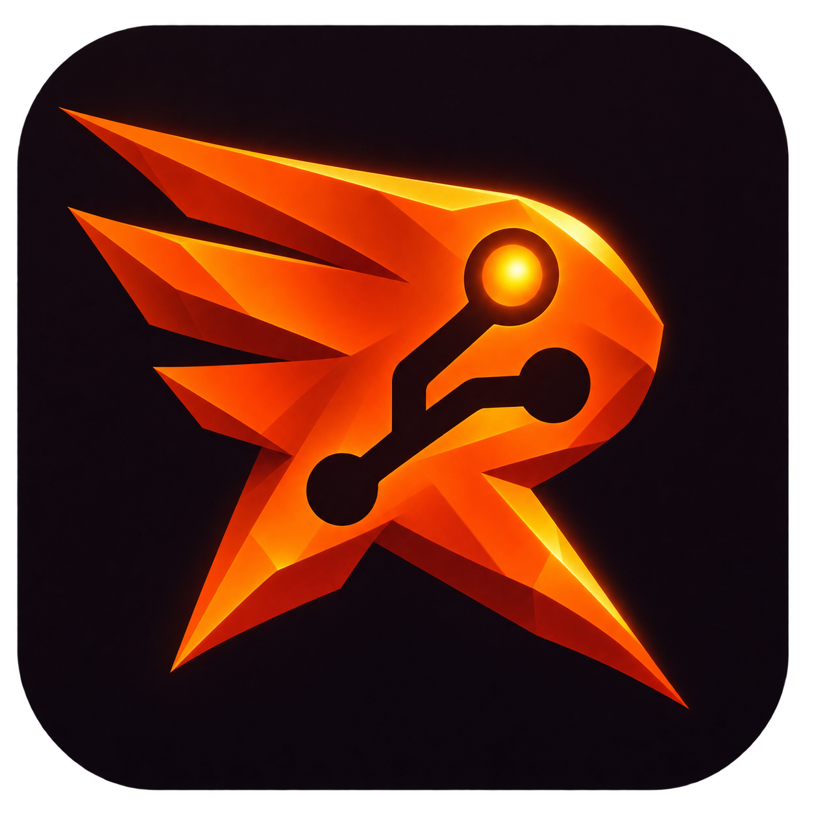

  

# Radon

Radon is a self-hostable Chrome extension designed to bring sprint goals and an epic-to-story timeline directly into GitHub Projects. Built for teams using the Nexus pipeline, it helps teams keep sprint goals in view and see how stories roll up into epics without leaving GitHub.

[Product context](docs/product/context.md)
